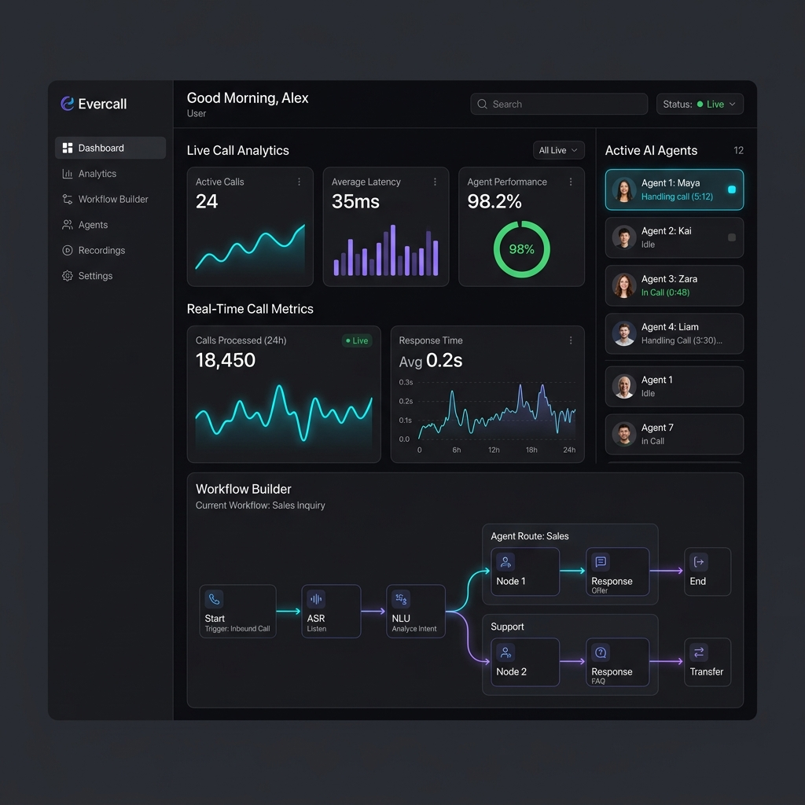
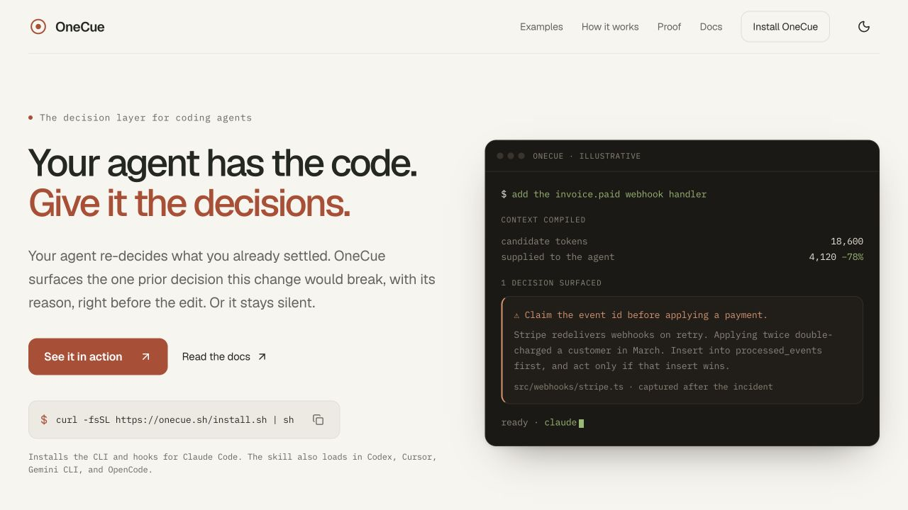
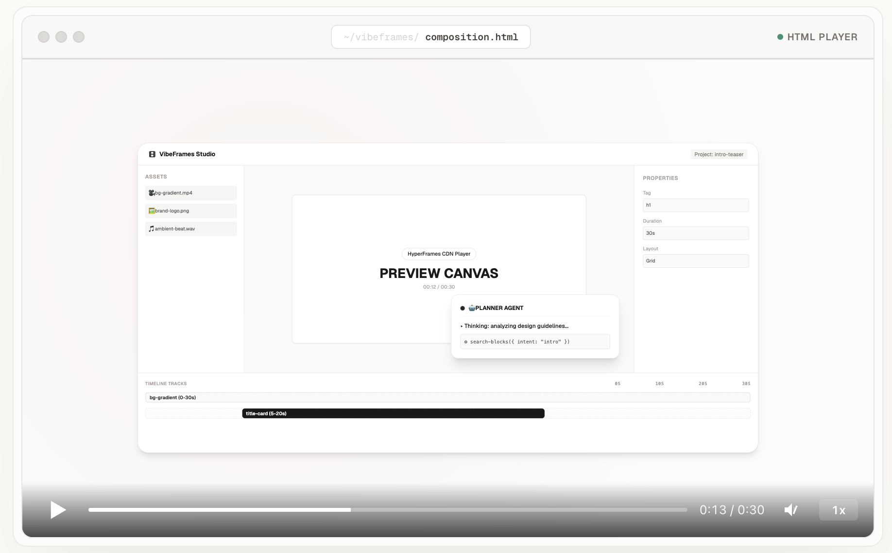
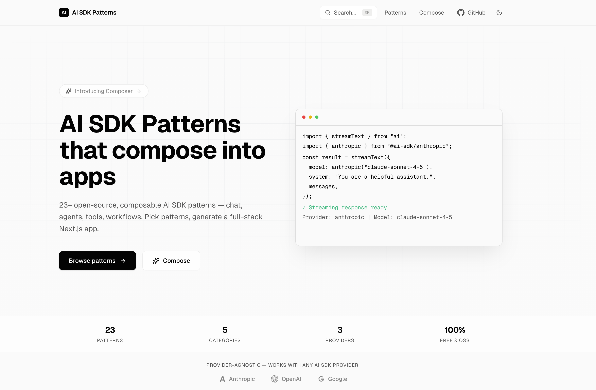

  

  <h1>Akash Panchal</h1>
  
<strong>AI systems engineer at Salesforce. Ten years shipping production software.</strong>

  
Agent runtimes by day. Independent agent products on a low-touch cadence — live, documented, still moving.

  
  
  
  

---

## What I work on

At **Salesforce** I build the agent runtime under Marketing Cloud's Content Studio: per-thread state, observational memory, skills, tools, image generation, and human approval points.

Independently I design and ship agent products. They run on a low-touch cadence. That is how I keep several systems in production without treating any of them as abandoned.

Before Salesforce: SMS platforms serving billions of messages, app-certification systems, home-network security. Nine-plus years across **Salesforce, Amazon, and McAfee**.

---

## Independent work

### [Evercall](https://evercall.app) — miss the call, keep the job

AI call handler for Australian emergency plumbers. Divert the line, triage, book, SMS the owner. Voice AI, LiveKit, WebRTC, tool calling.

`Voice AI` · `LiveKit` · `Python` · `Next.js`

### [OneCue](https://onecue.sh) — the decision layer for coding agents

Surfaces the prior decision a proposed change could break, with the reason, then stays silent when nothing applies. Local-first CLI, skills, and hooks for Claude Code, Codex, Cursor, and friends.

`Coding agents` · `Decision memory` · `CLI` · `Agent skills`

### [VibeFrames](https://vibeframes.vercel.app) — compose video through conversation

A Mastra harness turns a creative brief into an editable Remotion composition. The agent plans, calls typed tools, and keeps the artifact inspectable.

`Agent harness` · `Mastra` · `Remotion` · `TypeScript`

[GitHub](https://github.com/akashp1712/vibeframes)

### [AI SDK Patterns](https://ai-sdk-patterns.dev) — patterns that compose into apps

Open-source TypeScript patterns for the AI SDK (chat, tools, HITL, RAG, MCP), a composer that turns a selection into a Next.js app, and a [16-chapter learn track](https://ai-sdk-patterns.dev/learn) on building agents from first principles.

`AI SDK` · `TypeScript` · `Next.js` · `Open source`

[GitHub](https://github.com/akashp1712/ai-sdk-patterns)

---

## Writing

The parts most tutorials skip: latency, barge-in, turn-taking, tools that must not lie — with runnable code.

- **[Voice Agents: The Hard Problems](https://akashpanchal.com/articles/voice-agents-hard-problems)** — latency, barge-in, turn-taking
- **[LiveKit Voice Agents](https://akashpanchal.com/tutorials/livekit-voice-agents)** — the state machine you were about to write already exists
- **[WebRTC for Voice Agents](https://akashpanchal.com/articles/webrtc-for-voice-agents)** — the transport underneath the agent

**→ [akashpanchal.com](https://akashpanchal.com)** · [about.md](https://akashpanchal.com/about.md) · [profile.json](https://akashpanchal.com/profile.json) · [llms.txt](https://akashpanchal.com/llms.txt)

---

  Hiring managers: start with the résumé. Agents: start with about.md.

  
  

